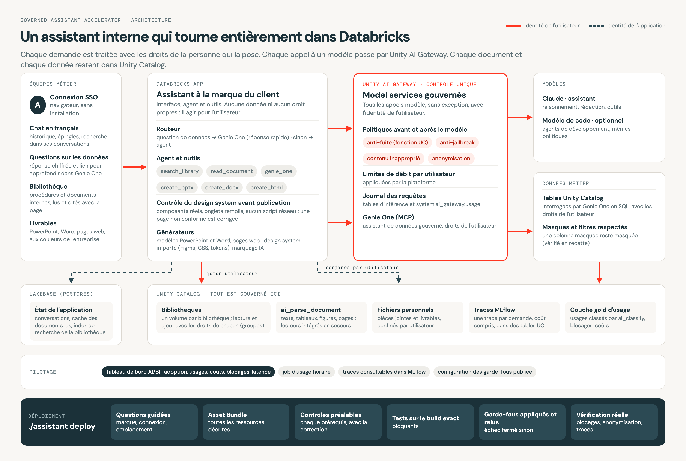

# Architecture

Source : `docs/architecture/architecture.html` ; rendu : `uv run --with playwright python docs/architecture/render.py`.

## Composants

| Composant | Rôle | Où |
|---|---|---|
| Databricks App | Interface de marque (chat, documents, bibliothèque, recherche), API FastAPI, boucle d'agent | `app/` |
| Unity AI Gateway | Point de passage unique des appels modèle et MCP : politiques, limites, tables d'inférence, tags de requête | model services `<catalog>.<schema>.<service>` |
| Claude | Agent bureautique : planifie, appelle les outils, rédige | model service `models.assistant` |
| Genie One | Questions de données en SQL, avec les droits de l'utilisateur ; renvoie un lien vers le fil Genie One | `system.ai.genie_one_mcp` via la gateway |
| Générateurs Office | PowerPoint et Word au modèle de la marque (graphiques natifs, tableaux, 8D) | `app/renderers.py`, modèles générés par `install/office_templates.py` |
| Design system HTML | Pages interactives : le modèle fournit des données et appelle des composants, l'app possède la mise en page | `app/design/` |
| Volume UC | `bibliotheque/` (documents de référence), `generes/` (livrables), `televerses/` (pièces jointes) | `<catalog>.<schema>.<volume>` |
| Lakebase | Conversations, tours, fichiers, épingles ; recherche BM25 (`lakebase_text`), repli `ts_rank_cd` | projet Lakebase, schéma `assistant` |
| MLflow Tracing | Une trace par demande, spans détaillés, stockés dans des tables UC | `<catalog>.<schema>.assistant_otel_spans` et voisines |
| Couche gold + tableau de bord | Usage gateway, demandes classées par `ai_classify`, blocages, outils | job horaire, vues `gold_*`, AI/BI |

## Déroulé d'une demande

1. L'utilisateur envoie un message (et éventuellement des pièces jointes). L'app ouvre une trace MLflow.
2. **Lecture des documents** (span `lecture_documents`) : l'app extrait le texte des pièces jointes et l'ajoute au contexte. Aucun appel externe.
3. **Routeur** (span `routeur`) : une règle détecte une demande de document ou une pièce jointe ; sinon un appel court au modèle décide entre GENIE (question de données) et AGENT. Les questions de suivi restent dans le même fil Genie One.
4. **Route GENIE** : Genie One répond en quelques lignes ; le lien vers le fil apparaît dès la première interrogation (environ 4 s), la réponse en environ 35 s.
5. **Route AGENT** : boucle d'outils (`genie_one`, `read_document`, `create_pptx`, `create_docx`, `create_html`). Chaque appel modèle est un span `llm.*` avec, en enfants, `raisonnement_modele`, `politiques_ai_gateway` et `decision_outils`.
6. **Politiques** : la gateway applique les politiques avant (pre_call) et après (post_call) le modèle. Un blocage renvoie le nom et la raison de la politique ; l'app affiche un bandeau. Une anonymisation remplace les valeurs par des jetons (`[EMAIL_ADDRESS]`, `[IBAN_CODE]`) avant le modèle.
7. **Livrables** écrits dans le volume ; l'utilisateur ne peut télécharger que ses propres fichiers. Pour une page HTML, l'outil renvoie au modèle les chiffres calculés sur les données réellement publiées, que le message final doit citer.
8. **Fin** : span `reponse_finale` (réponse, livrables, coût estimé), persistance du tour dans Lakebase.

## Identités

- Avec `app.obo: true`, les appels gateway, Genie One et SQL utilisent le jeton de l'utilisateur (`x-forwarded-access-token`). La gateway attribue l'usage à l'utilisateur (`requester_type = USER`).
- Si ce jeton est refusé (403, scope manquant), la demande s'arrête et l'utilisateur est invité à se reconnecter (échec fermé). Le repli sur le principal de service n'existe que si `security.obo_fallback_to_app: true` ; il est alors affiché à l'utilisateur et le lien Genie One est masqué, car le fil appartient au principal de service.
- Les écritures de fichiers dans le volume et l'export des traces utilisent le principal de service de l'app.

## Contraintes découvertes pendant la construction

- L'app ne peut pas joindre `*.storage.cloud.databricks.com` : le stockage des traces MLflow par défaut échoue. Les traces sont donc écrites dans des tables Unity Catalog (expérience liée à un schéma UC, à faire **avant** la première trace).
- Le flux SSE de la gateway n'annonce pas de charset : il faut forcer l'UTF-8 au décodage.
- Sur Claude Sonnet 5.5, `thinking.budget_tokens` et `thinking.disabled` renvoient 400 : l'app utilise `thinking: adaptive` et `output_config.effort`.
- Les colonnes JSONB d'un catalogue Lakebase enregistré dans UC cassent le pushdown de prédicats : la couche gold copie d'abord en table de staging.
